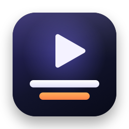

<p align="center"></p>

<h1 align="center">BetterDualSub</h1>

<p align="center">为 macOS 版 Apple TV 应用添加外挂双语字幕。</p>

<p align="center"><a href="README.md">English</a> | <strong>简体中文</strong></p>

Mac 上的 Apple TV 应用（TV.app）一次只能显示一种字幕，也不能加载自己的字幕文件。BetterDualSub 在视频上方的浮层中显示一到两条字幕，并跟随正在播放的影片同步，例如可以同时显示英文和中文。

## 功能

- **三种字幕来源**：从 Apple TV 电影链接下载、从 TV.app 下载的剧集（`.movpkg`）或视频文件的内嵌文字字幕轨（`.mkv`、`.webm`、`.mp4`、`.m4v`、`.mov`）中提取，或打开自己的 `.srt`、`.vtt`、`.ass`、`.ssa` 文件。
- **两条字幕同时显示**，各自设置字体、颜色、描边和换行方式。
- **跟随播放**：跟随 TV.app，或任何会上报“正在播放”信息的播放器（IINA、VLC、QuickTime Player、浏览器等），包括暂停、拖动进度和倍速。没有播放时改用手动时钟。
- **同步状态可见**：菜单栏、字幕浮层和控制窗口都会显示同步状态；没有跟随正确的播放器时，可一键修正。
- **时间校准**：每条轨道单独设置延迟、全局快捷键微调、选中正在播放的台词自动对齐。校准按片名保存。
- **翻译**：用 macOS 端侧翻译、本地语言模型（Ollama、LM Studio）或任何兼容 OpenAI 接口的服务由第一轨生成第二种语言。跨多行的句子整句翻译后再按原时间轴拆回，每部剧的术语表让人名和专有名词前后一致。
- **双语导出**：把两个字幕文件合并为一个双语 SRT。
- 界面支持简体中文和英文。

## 系统要求

- 搭载 Apple 芯片、运行 macOS 26 或更高版本的 Mac。
- TV.app，或其他会上报“正在播放”信息的播放器。

## 安装

### Homebrew（推荐）

```sh
brew tap kearney3/betterdualsub https://github.com/Kearney3/BetterDualSub
brew trust --cask kearney3/betterdualsub/betterdualsub
brew install --cask betterdualsub
```

Homebrew 只安装你信任的第三方 tap 中的 cask；`brew trust` 只放行这一个 cask，不会放行该 tap 中的其他内容。用 `brew upgrade --cask betterdualsub` 升级。有新版本时，应用也会提示。

### 手动安装

1. 从 [Releases](https://github.com/Kearney3/BetterDualSub/releases) 下载 DMG，把 BetterDualSub 拖到「应用程序」文件夹。
2. BetterDualSub 未经 Apple 公证，需要先在终端中运行一次以下命令，macOS 才允许打开：

   ```sh
   xattr -cr /Applications/BetterDualSub.app && codesign --force --deep --sign - /Applications/BetterDualSub.app
   ```

通过 Homebrew 安装时会自动完成这一步。

有新版本时，**设置** › **通用** 中会出现 **安装更新…**，点击后会下载新版本、校验签名并重新打开应用。通过 Homebrew 安装的仍用 `brew` 升级。

## 快速开始

1. 首次启动时，欢迎页会介绍三个步骤，点击 **加载字幕** 即进入加载页（之后可从 **帮助** › **BetterDualSub 使用引导** 再次打开）。选择 **加载字幕**。可拖入一到两个字幕文件、视频文件或 `.movpkg` 包，也可粘贴影片链接并点击 **识别来源**。
2. 按识别出的来源选择轨道并加载；影片链接需要先查找字幕，再选择版本与语言。
3. 在 TV.app 中播放同一片名、同一版本，并关闭其自带字幕。
4. **正在播放** 页的「开始使用」清单会在加载字幕、跟随到播放器、确认看到浮层后自动勾选，并为当前未完成的步骤给出对应操作。
5. 字幕偏早或偏晚时，按 Control-Option-← 或 →（每次 250 毫秒），或使用 **按字幕对齐**。

## 使用说明

控制窗口分为三组：

| 分组 | 页面 |
| --- | --- |
| 字幕 | **正在播放**：当前字幕的轨道、同步状态、时间校准和翻译。**加载字幕**：所有加载字幕的方式。 |
| 工具 | **按字幕对齐**、**双语导出** |
| 设置 | **外观**、**翻译**、**快捷键**、**通用** |

菜单栏图标也提供加载、时间和显示相关的命令。

### 加载字幕

| 来源 | 需要提供 | 说明 |
| --- | --- | --- |
| 影片链接 | Apple TV 电影页面链接 | 列出所选版本的字幕轨道。**仅下载保存…** 只保存 SRT 文件，不显示。 |
| 本地视频 | 带内嵌文字字幕的视频文件（`.mkv`、`.webm`、`.mp4`、`.m4v`、`.mov`，支持 SRT、ASS/SSA、WebVTT、tx3g 字幕轨），或 TV.app 下载的 `.movpkg` 包（通常位于 `~/Movies/Videos/Media.localized/TV Shows`） | `.movpkg` 可选择单集时间线或整个包的时间线。视频文件只需读取一遍即可取得全部字幕轨，在 **正在播放** 中切换轨道无需等待；不支持 PGS、VobSub 等图形字幕。第二轨可选其他轨道、不显示，或 **由第一轨翻译生成**：只提取第一轨，随后在 **正在播放** 中直接翻译出第二语言。**导出 SRT 文件…** 只保存副本，不显示。 |
| 字幕文件 | 一到两个 `.srt`、`.vtt`、`.ass`、`.ssa` 文件 | 自动识别 UTF-8、UTF-16 及常见旧编码（GB18030、Big5、Shift JIS、EUC-KR）。ASS/SSA 的样式会被忽略；字幕正文中的粗体、斜体、下划线和颜色（HTML 风格标签、WebVTT 类、`{\i1}` 一类的覆盖标记）会正常显示。文件名以 `(-1500ms)` 结尾时会自动设置延迟。 |

加载成功后，窗口会切换到 **正在播放**。电影下载与本地提取会记住你选择的语言组合；不支持的链接会给出本地字幕和本地视频入口。

### 最近观看

**正在播放** 页面在 100 MiB 总容量内最多保存最近 10 次观看的字幕副本、译文、轨道延迟和外观。达到上限时优先移除旧记录，单条记录过大时会报错并保留已保存的数据。点击 **恢复** 即可重新加载，无需原始文件或再次下载。恢复后跟随播放器当前位置，不会跳转视频。可逐条移除或清空；原始文件与手动导出文件会保留。

### 同步状态

| 状态 | 含义 |
| --- | --- |
| 正在跟随 · 播放中 / 已暂停 | 字幕跟随所选播放器。 |
| 等待 … 播放 | 所选播放器没有在播放，期间使用手动时钟。如果有其他应用正在播放，可以一键改为跟随它。 |
| 手动时钟 | 你选择了手动计时，可使用鼠标悬停在字幕上时出现的进度条。 |
| 正在连接播放信息 | 等待监听器首次响应，连接失败后会按有上限的间隔自动重试。 |
| 播放信息连接中断 | 读取系统播放信息中断，BetterDualSub 会自动重连。 |

在 **通用** › **同步来源** 中选择要跟随的播放器。连接时钟不代表字幕内容已匹配；页面会区分当前有字幕、对白间隙和超出覆盖范围，并提供对齐和更换字幕入口。

**导出诊断信息…** 会把版本、时钟状态、轨道条数、延迟和最近的状态事件保存为本地 JSON，不含字幕正文、片名、文件路径、来源链接或账号标识，也不会自动上传。

### 时间校准

- **延迟**：正数表示字幕延后。可在 **正在播放**、浮层控制条或用快捷键设置。除非取消关联，第二轨会与第一轨保持一致。
- **按字幕对齐**：某句台词正在播放时，在列表中选中它并点击 **对齐到当前播放时间**，延迟会自动算出。列表会标出按当前延迟应显示的台词，点击 **定位当前台词** 可滚动回该行。
- **倍速播放**：字幕时间与视频时间按 1:1 对应。视频 2 倍速播放时，字幕也按 2 倍速播放；悬浮窗会显示播放器的倍速。在悬浮窗控制栏点准星按钮，也可以直接按字幕对齐。
- 延迟按字幕内容与来源版本保存，下次加载相同字幕时会自动恢复并提示。旧版按片名保存的校准会迁移一次，避免其他同名版本重复继承。

### 翻译生成第二语言

在 **正在播放** 中，**翻译生成第二轨** 会由第一轨生成第二轨，并自动识别源语言。可手动修正源语言，先 **试译前 8 条**，试译不会替换第二轨。完整翻译后可 **撤销第二轨替换**。生成的字幕可导出为 SRT，并会保存在最近观看中。

选择 **引擎**：

- **端侧翻译（macOS）**：系统翻译。尚未安装的语言会弹出系统下载提示，字幕内容不会离开你的 Mac。
- **语言模型**：在 **设置** › **翻译** 中配置。选择 **Ollama** 或 **LM Studio** 使用本机运行的模型，或选择 **OpenAI**、**DeepSeek**、**自定义** 接入任何提供 OpenAI 兼容 `/v1/chat/completions` 接口的服务（OpenRouter、SiliconFlow、通义千问、llama.cpp 等）。模型输入框旁的 **获取模型列表** 会列出服务提供的模型供选择。API 密钥保存在登录钥匙串中，仅用于该地址。每次请求会附带前后文句子，让人名和语气保持一致；也可以填写附加指令，例如剧情简介。在 **提示词** 中选择译者的角色和风格：**标准**、**贴近原文**（贴近原文用词和句式，便于对照）、**本地化意译**（俗语、笑话换成观众熟悉的说法），或你自己的提示词。**查看…** 可看到内置提示词，以及按当前设置生成的完整提示词；**复制为我的提示词** 或 **新建…** 可保存自己的提示词，其中 `{source}`、`{target}` 代表源语言和目标语言。字幕分段、术语表、上下文和回复格式的规则始终由应用自动加上，换用任何提示词都不影响翻译。在 **人名与风格** 中可以让人名、地名保留原文写法而不翻译，保留 -san、-kun、oppa 等敬称，以及弱化粗口。

时间轴：

- 一句话被拆在多条字幕中时（"I don't think" / "we should go."），会合成整句翻译，再拆回原来的几条字幕。语言模型会自行返回对应的分段；端侧翻译的结果按原文各行的长度比例，在标点或词语之间拆分。
- **在原时间段内拆分过长的译文**：译文超过两行时，在原字幕的时间内拆成依次显示的几条。
- **字幕式标点**（中文、日文）：去掉译文中的句号和逗号，句内停顿处改为空格，符合这两种语言字幕的通常写法。

术语表：

- 每部剧在每种目标语言下有一份术语表，按去掉集数后的标题命名（`Show.Name.S01E02` → `Show Name`），所有剧集共用。点 **编辑…** 打开；可导入、导出制表符分隔的文本（`原文<TAB>译文<TAB>类型<TAB>备注`，`#` 开头为注释，也能读取 `原文 → 译文` 格式）。
- 使用语言模型时，**抽取术语** 或 **翻译前自动抽取人名和术语** 会收集人名、地名、组织名以及剧中特有的名词。你写过或改过的条目不会被覆盖。选择人名或地名保留原文时，自动找到的这类条目仍留在术语表中但不会使用；你自己填写的条目照常生效。
- 每次请求都会附带其中出现的术语译名。翻译完成后，仍未使用术语译名的句子会再翻译一次，剩余的会提示出来。使用端侧翻译时，会在翻译前把术语译名写入原文，对人名效果最好。

### 字幕浮层

字幕可以拖到屏幕任意位置。鼠标悬停时会出现控制条，可控制播放、延迟和对齐；右键可打开外观设置、锁定、隐藏或重置位置。锁定后浮层不响应鼠标，不影响下方的应用。**外观** 中可设置字体、颜色、描边（绘制在文字外侧，不再遮挡笔画）、柔和阴影、背景，以及保持原样、合并为单行或平衡为两行。

在 **通用** › **字幕显示屏幕** 中选择固定屏幕或当前主屏幕。各屏幕分别记住字幕位置和字号；指定屏幕断开时自动回到可用屏幕。

### 快捷键

以下快捷键在任何应用中都可用，可在 **快捷键** 中修改，也可设置延迟步长（1 到 60,000 毫秒，默认 250 毫秒）。

| 操作 | 默认快捷键 |
| --- | --- |
| 第一轨提前 / 推迟 | Control-Option-← / → |
| 第二轨提前 / 推迟 | Control-Option-Shift-← / → |
| 重置第一轨 / 第二轨延迟 | Control-Option-0 / Control-Option-Shift-0 |
| 播放 / 暂停 | Control-Option-Command-Space |
| 后退 / 前进 10 秒 | Control-Option-Command-← / → |
| 锁定 / 解锁浮层 | Control-Option-L |

播放、暂停和跳转作用于正在跟随的播放器；没有跟随的播放器时，作用于手动时钟。

## 限制

- 在线下载仅支持带有 iTunes 购买或租赁选项的 Apple TV **电影页面**。不支持 Apple TV+ 订阅内容，也不支持剧集、季或单集链接；TV.app 中下载的剧集请使用 **本地视频**。
- 可用语言取决于页面所在的国家或地区以及影片版本。只会列出外挂文本字幕轨道，无法下载视频内嵌的字幕。强制字幕通常只包含部分对白。
- 加密、不连续、字节范围以及带初始化映射的字幕播放列表会被拒绝并报错。
- BetterDualSub 不会识别正在播放的影片，请加载同一片名、同一版本的字幕。版本不同时可能仍需调整延迟。

## 隐私

- **网络**：只有在你查找或下载字幕时才会访问 Apple TV 网站；每天最多一次向 GitHub 查询最新版本号（可在 **通用** 中关闭）。除此之外不发送任何内容。
- **账号**：请求默认匿名。可选的 DSID 字段仅在符合条件的请求失败后使用，且只保存在内存中。
- **翻译**：使用 macOS 端侧翻译或本机语言模型时在本机完成。使用在线语言模型服务时，字幕文本会发送到该服务，翻译卡片和 **设置** › **翻译** 中都会提示。API 密钥保存在登录钥匙串中；术语表保存在 `~/Library/Application Support/BetterDualSub/Glossaries/`。
- **文件**：下载和提取的字幕保存在 `~/Library/Application Support/BetterDualSub/Subtitles/`，可在 **通用** 中移到废纸篓；你自己导出的文件不会被改动。设置和校准存放在应用的偏好设置中；最近观看的字幕副本、译文和配置保存在 `~/Library/Application Support/BetterDualSub/RecentWatching.json`，需从「最近观看」清空，清理下载缓存不会删除这些副本。

通过 Homebrew 安装的，运行 `brew uninstall --zap --cask betterdualsub` 可移除全部内容。

## 常见问题

<details>
<summary>macOS 提示 BetterDualSub 已损坏或无法打开</summary>

应用未经 Apple 公证。请用 Homebrew 安装，或运行一次[手动安装](#手动安装)中的终端命令。
</details>

<details>
<summary>影片在播放，字幕却不动</summary>

查看 **正在播放** 或菜单栏中的同步状态。如果提示另一个应用正在播放，点击 **改为跟随**，或在 **通用** › **同步来源** 中选择播放器。如果显示 **手动时钟**，请切换回自动。
</details>

<details>
<summary>字幕越往后偏得越多</summary>

字幕文件的帧率或剪辑版本与片源不同。BetterDualSub 保持字幕与视频时间 1:1，请下载与当前片源版本匹配的字幕。
</details>

<details>
<summary>影片链接找不到字幕轨道</summary>

请查看[限制](#限制)。不支持 Apple TV+ 内容和剧集链接，且可用语言取决于页面所在的国家或地区，可以换用其他国家或地区商店的链接试试。
</details>

<details>
<summary>翻译提示需要下载或翻译失败</summary>

macOS 需要安装对应的语言。接受下载提示，或在“系统设置 › 通用 › 语言与地区 › 翻译语言”中管理。

使用语言模型时，可在 **设置** › **翻译** 中点 **测试连接**。本地服务需已启动并下载好模型（`ollama pull <模型>`）。小模型经常漏句时，可调小 **每次请求的句数**。
</details>

## 开发

用 Xcode 26 打开 `BetterDualSub.xcodeproj`，或在命令行中构建并启动：

```sh
./script/build_and_run.sh
```

构建 Release 版本：

```sh
xcodebuild -project BetterDualSub.xcodeproj -scheme BetterDualSub -configuration Release build
```

### 测试

字幕解析、时间计算、翻译规划、播放跟踪和下载逻辑都在 `BetterDualSubCore` Swift 包中，无需启动 TV.app 即可测试：

```sh
swift test
```

另有一个可选的在线测试，会从真实电影链接下载英文和中文字幕：

```sh
BETTERDUALSUB_LIVE_MOVIE_URL='https://tv.apple.com/hk/movie/spider-man-into-the-spider-verse/umc.cmc.4a2ypxddplsdsahwxrc5fkz4x' \
  swift test --filter testLiveAppleMovieLinkWhenRequested
```

如果安装了多个 Xcode，请在命令前加上 `DEVELOPER_DIR=/Applications/Xcode.app/Contents/Developer`。

### 项目结构

| 路径 | 内容 |
| --- | --- |
| `BetterDualSub/SubtitleDocument.swift` | 字幕模型、SRT/WebVTT/ASS 解析、时间计算 |
| `BetterDualSub/PlaybackTracking.swift` | “正在播放”跟踪、同步状态、校准保存 |
| `BetterDualSub/MovieSubtitleDownloader.swift`、`MovpkgSubtitleExtractor.swift`、`VideoSubtitleExtractor.swift` | Apple TV 下载、`.movpkg` 提取，以及 Matroska / MP4 内嵌字幕提取 |
| `BetterDualSub/SubtitleManager.swift`、`PlaybackCoordinator.swift` | 字幕会话、播放协调与监听器恢复 |
| `BetterDualSub/ContentView.swift` | 字幕渲染与浮层交互 |
| `BetterDualSub/*View.swift` | 控制窗口各页面 |
| `Tests/` | 核心包的单元测试 |
| `Casks/betterdualsub.rb` | Homebrew cask |
| `docs/` | 调研笔记与提交规范 |

### 参与开发

提交信息遵循 [Conventional Commits](docs/commit-convention.md)。每次克隆后启用一次本地校验：

```sh
git config core.hooksPath .githooks
```

### 发布

推送 `v*` 标签，如 `v1.1.0`。发布流程会运行测试、构建 arm64 DMG、发布附带已签名 Sparkle `appcast.xml` 的 GitHub Release，并更新 Homebrew cask 中的版本和校验值。

应用内更新使用 Sparkle EdDSA 密钥签名，私钥保存在仓库 secret `SPARKLE_PRIVATE_KEY` 中；缺少该 secret 时发布流程会中止。首次配置（需先让 Xcode 解析完依赖包）：

```sh
SPARKLE_BIN="$(find ~/Library/Developer/Xcode/DerivedData -path '*artifacts/sparkle/Sparkle/bin' -type d | head -1)"
"$SPARKLE_BIN/generate_keys"                      # 在登录钥匙串中生成密钥
"$SPARKLE_BIN/generate_keys" -x sparkle-key.txt   # 导出密钥
gh secret set SPARKLE_PRIVATE_KEY < sparkle-key.txt && rm sparkle-key.txt
```

请妥善保留钥匙串中的密钥：已安装的应用会拒绝用其他密钥签名的更新。公钥在构建时由 secret 推导，因此本地构建不含公钥，会改为打开下载页面。

## 致谢

- Apple TV 电影接口的发现流程参考了 [iSubRip](https://github.com/MichaelYochpaz/iSubRip)（MIT），并用 Swift 原生重新实现。署名与源码分析见 [`ThirdPartyNotices.txt`](BetterDualSub/ThirdPartyNotices.txt) 和 [`docs/isubrip-download-research.md`](docs/isubrip-download-research.md)。
- 播放信息通过 [mediaremote-adapter](https://github.com/ejbills/mediaremote-adapter) 读取。
- 应用内更新使用 [Sparkle](https://sparkle-project.org)（MIT）。

BetterDualSub 与 Apple 无关联，也未获 Apple 认可。Apple TV 是 Apple Inc. 的商标。
